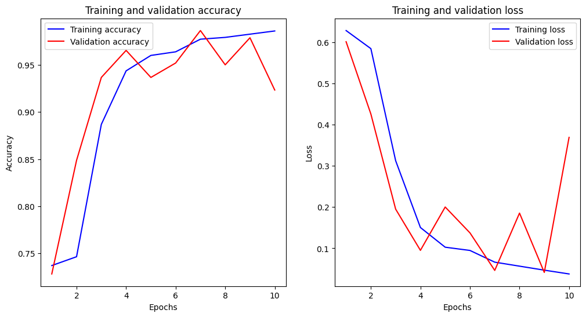

# Chest X-ray Pneumonia Classifier

A convolutional neural network that classifies chest X-rays as pneumonia or normal. Written in TensorFlow/Keras and trained on Kaggle.

## Data

[Chest X-Ray Images (Pneumonia)](https://www.kaggle.com/datasets/paultimothymooney/chest-xray-pneumonia) from Kaggle, using its train, val and test folders. Images are loaded with OpenCV as grayscale, resized to 150x150, shuffled and scaled to the 0 to 1 range.

## Model

A stacked CNN built with the Keras Sequential API. Convolution blocks grow from 32 to 320 filters, each followed by ReLU and max pooling, then flatten into dense layers for the final prediction.

## Results

Trained for 10 epochs.

| Set | Accuracy |
| --- | --- |
| Train (final epoch) | 98.91% |
| Validation split (best epoch) | 97.89% |
| Validation split (final epoch) | 92.34% |
| Held out test set | 90.33% |

The test set figure is the one to trust. Validation falling from 97.89% to 92.34% in the final epoch, with a test loss of 1.10, points to overfitting, so early stopping is the next thing to add. The dataset's own val folder holds very few images, so its 62.5% score is too small a sample to read much into.

## Run it

Open `chest-x-ray-images-pneumonia-8.ipynb` on Kaggle with the dataset attached, or point `Train_dir`, `Test_dir` and `Val_dir` at a local copy.
